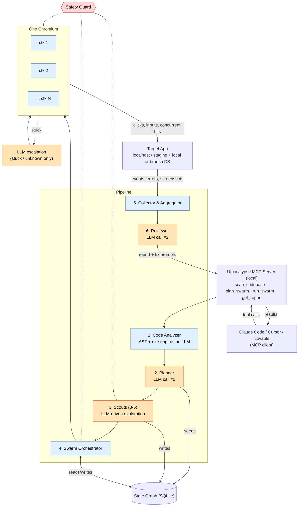
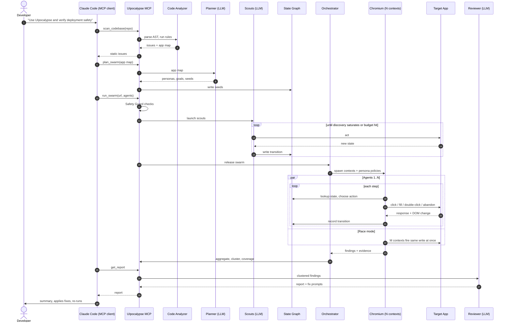

# UIpocalypse: Architecture

**Status:** Draft v0.1 · **Date:** 2026-11-13

## 1. Principles

1. **LLM at the edges, code in the middle.** The model plans, explores unfamiliar states, and writes the report. The hot loop is deterministic code.
2. **Real browser is the oracle.** We never simulate the browser. Findings come from observed behavior.
3. **Learn once, reuse everywhere.** A shared state graph turns the first agent's slow exploration into every later agent's fast path.
4. **Safe by default.** Local/staging only, destructive actions skipped, load rate-limited.
5. **Local-first.** Source code never leaves the user's machine (only structured summaries go to the LLM).

## 2. System overview

Orange = uses an LLM. Blue = plain code. Red = safety.

## 3. Components

| # | Component | Responsibility | LLM? |
|---|---|---|---|
| 0 | **MCP Server** | Tool surface, config loading, progress streaming, run lifecycle | No |
| 1 | **Code Analyzer** | AST parse, app map extraction, static rules, issue output | No |
| 2 | **Planner** | App map → personas, goals, seed states, nasty-input sets (validated JSON) | 1 call |
| 3 | **Scouts** | Slow, LLM-driven exploration to populate the state graph | Yes (3-5 agents) |
| 4 | **Swarm Orchestrator** | Spawns contexts, assigns personas, runs barrier/race mode, enforces budgets | No |
| 5 | **In-page Runtime** | Injected script: state signature, action enumeration, event capture, action execution | No |
| 6 | **State Graph** | SQLite store of states, actions, transitions, visit counts, coverage | No |
| 7 | **Safety Guard** | Host allow-list, prod refusal, destructive-action filter, rate limiter | No |
| 8 | **Collector** | Dedupe/cluster findings, compute coverage, attach evidence | No |
| 9 | **Reviewer** | Cluster list → report + fix prompts | 1 call |

## 4. Run sequence

## 5. Data flow

1. **Repo → app map** (Analyzer): routes, elements, handlers, API calls, tables, env vars.
2. **App map → plan** (Planner): personas, goals, seeds. Only a summary crosses to the LLM.
3. **Plan + seeds → state graph** (initial nodes/edges, unvisited).
4. **Scouts → graph**: observed transitions fill in the map.
5. **Swarm ↔ graph**: agents read visit counts to prefer unexplored actions and write new transitions.
6. **Browser events → collector**: raw events become findings with evidence.
7. **Findings → reviewer → report**: clustered, ranked, mapped back to code via the app map.

## 6. Key design decisions

| # | Decision | Rationale | Alternatives rejected |
|---|---|---|---|
| D1 | Do **not** fork Chromium | Maintenance burden is huge; the bottleneck is the LLM loop, not the browser | Custom browser, Lightpanda as primary |
| D2 | **Contexts**, not tabs | Isolated cookies/storage per simulated user; ms spin-up | 50 tabs (shared session), 50 browsers (RAM) |
| D3 | Swarm agents are **code policies** | Speed and cost: no LLM per step | 50 LLM-driven agents (minutes, expensive, rate limits) |
| D4 | **Shared state graph** keyed by normalized accessibility signature | Reuse exploration across agents and runs | Per-agent exploration |
| D5 | Accessibility/DOM text over screenshots | Orders of magnitude cheaper and faster | Screenshot loop |
| D6 | Static code scan **before** the swarm | Seeds the graph, flags obvious issues instantly | Pure black-box crawl |
| D7 | MCP server, local | Fits AI-coding workflow; code stays local | Hosted-only SaaS |
| D8 | SQLite | Zero-ops, embeddable, queryable | Postgres, JSON files |
| D9 | In-page runtime + thin runner | Few CDP round trips per step | Pure Playwright locator calls per element |
| D10 | Lightpanda/jsdom as optional fast pre-pass (later) | Cheap first filter; Chromium remains the oracle | Replacing Chromium |

## 7. Deployment topology (MVP)

Everything runs on the developer's machine: MCP server process (stdio) → Playwright-managed Chromium → target app on localhost/staging. Only LLM API calls leave the machine, carrying structured summaries (app map, clustered findings, accessibility text), not source files. Optional later: a cloud runner for 100+ agents and CI.

## 8. Scalability limits to be aware of

- ~50-150 MB per context, so ~30 contexts is comfortable on a laptop; beyond ~50, use more cores/RAM or multiple Chromium processes.
- The **target app** is often the bottleneck (DB connection limits, free-tier rate limits). The orchestrator ramps concurrency and reports the level at which the app degraded.
- First run is dominated by scouts' LLM latency; reruns are dominated by app response time.

## 9. Cross-cutting concerns

- **Reproducibility:** seeded RNG per agent; each finding stores seed + action history.
- **Observability:** structured run log, timing per phase, LLM call count and cost estimate, coverage report.
- **Privacy:** no source upload; redact secrets from any summary sent to the LLM; `--no-llm` mode.
- **Extensibility:** persona and rule plug-in interfaces; stack adapters (Next.js + Supabase first; Vite, SvelteKit, Firebase later).
