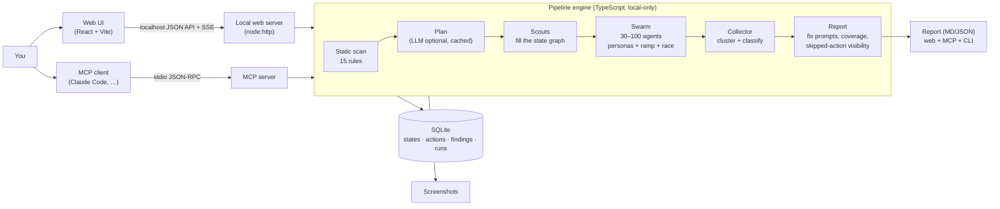

<div align="center">


# UIpocalypse

**50 chaotic test users try to break your app in a couple of minutes — locally.**

Chaotic-user QA for vibecoded apps: a static code scan plus a browser swarm of adversarial personas (double-clickers, garbage-pasters, race-runners) finds dead buttons, double-submits, races, crashes, and launch-safety holes in a test copy of your app — then writes the report with paste-ready fix prompts.

`UIpocalypse | break it here, not in production`

[Features](#features) · [How to use](#how-to-use) · [Architecture](#architecture) · [Tech stack](#tech-stack) · [Safety](#safety) · [Repo layout](#repository-layout)

</div>

---

## Features

- **Static code scan** — 15 rules for dead handlers, unwired forms, missing guards, exposed secrets, missing RLS, undefined env vars. Runs in ~1 s before any browser opens.
- **Chaos swarm** — 30–100 headless agents explore your app like hostile users: they wander, double-click money buttons, paste garbage into forms, abandon flows mid-way, and fire coordinated races.
- **Honest reports** — findings are clustered with reproduction steps, raw evidence, and a copy-paste **fix prompt** for your coding agent. Coverage is reported with real denominators, skipped actions are listed (never silent), and the report says what was **NOT** tested.
- **Two surfaces, one engine** — a local **web UI** (live run view, state graph, run comparison) and a **MCP server** for Claude Code / any MCP client.
- **Safety-first by default** — localhost-only targets, destructive actions never clicked without explicit opt-in, writes gated on a confirmed-safe database, and LLM use is fully optional and always visible.

## How to use

### The web UI

```bash
# from this repo:
cd uipocalypse
npm install && npm run build          # the tool (Node 22+)
cd ../frontend && npm install && npm run build   # the UI
cd ../uipocalypse
npx playwright install chromium       # one-time, the browser the swarm drives
node dist/index.cjs web               # → http://127.0.0.1:4310
```

Then in the browser:

1. **Connect project** — your app's absolute repo path (verified with a real static scan) + the localhost URL it's running on, then confirm the two safety checklist items.
2. **New run** — pick agent count and time budget, launch, and watch the phases stream live (Scan → Plan → Scout → Swarm → Report).
3. **Report** — findings with root cause, repro steps, evidence, and a **Copy fix prompt** button; skipped-by-policy actions; coverage funnel; the state graph of your app; run diffs for fix-verify loops.

### The MCP server (Claude Code / any MCP client)

```json
{
  "mcpServers": {
    "uipocalypse": {
      "command": "node",
      "args": ["/absolute/path/to/uipocalypse/dist/index.cjs"],
      "env": { "UIP_WORKSPACE": "/absolute/path/to/uipocalypse" }
    }
  }
}
```

Then: *"use uipocalypse to verify deployment safety: the repo is /path/to/my-app and the app is running at http://localhost:3000"* — one tool call chains the whole pipeline. Tools: `scan_codebase`, `plan_swarm`, `run_swarm`, `get_report`, `list_runs`, `diff_runs`, `verify_deployment_safety`.

### Prerequisites & the LLM

- **Node 22+** and a Chromium (installed by the steps above).
- **The app under test must be running on localhost** — and it must be a **disposable test copy**, never production.
- **No LLM key required**: with no key everything runs fully local and you get a mechanical report. With a key (read only from the MCP `env` block or `~/.uipocalypse/config`, never from `.env` files) you additionally get the LLM-written review. Every run prints its mode — `LLM mode: on/off, provider, key source` — before anything happens.

## Architecture



Everything runs on your machine. The only outbound traffic, ever, is optional redacted summaries to the LLM provider you configure.

## Tech stack

| Layer | Choices |
|---|---|
| **Engine** | TypeScript (strict), Node.js 22, esbuild bundle |
| **Browser automation** | Playwright (Chromium), in-page runtime injected per page |
| **State model** | SQLite via better-sqlite3 — states / actions / transitions graph, findings, runs (with machine stamps) |
| **LLM layer** | Any OpenAI-compatible provider; fallback chains; fail-fast health checks; mode line on every run |
| **MCP** | @modelcontextprotocol/sdk (stdio) |
| **Web UI** | React 19, Vite 8, Tailwind CSS v4, self-hosted Inter + JetBrains Mono (zero external requests) |
| **Safety** | Guard layer: localhost-only targets, destructive-label regex, DB allow-list, secret redaction on every LLM payload |

## Safety

- Targets are **localhost only** unless you explicitly allow-list a host.
- Destructive-looking controls (delete / reset / remove / …) are **never clicked** without an explicit per-run opt-in — and the report lists every skipped control with its reason.
- Apps with only a production database get a **read-only run**; the report says so in its first lines. A clean read-only report is never a clean bill of health.
- Your code, secrets, and screenshots never leave the machine. The optional LLM sees only redacted, secret-free summaries.

**This is experimental software.** Read [`uipocalypse/README.md`](uipocalypse/README.md#scope-and-limits) for the honest scope-and-limits list (detection blind spots, untestable bug classes, known variance), and [`BENCHMARK_RESULTS.md`](BENCHMARK_RESULTS.md) for the benchmark record.

## Repository layout

```
uipocalypse/        the engine: analyzer, browser runtime, swarm, collector,
                    reviewer, MCP server, web backend, CLI, tests (141)
frontend/           the web UI (React + Vite + Tailwind), talks to the
                    localhost web API
sample-app/         a demo Next.js + Supabase app with planted bugs
held-out-app-2/     Plain Pages — the held-out detector check fixture
benchmarks/         raw benchmark data and gate logs
docs/volunteer/     the volunteer kit: quickstart, safe-test-copy guide,
                    what-we-see privacy doc, feedback + log templates
releases/           volunteer handoff tarballs (gitignored) + sha256
```

## License

Placeholder (MIT text) pending the owner's confirmation — see [`uipocalypse/LICENSE`](uipocalypse/LICENSE). Terms of use: [`uipocalypse/TERMS.md`](uipocalypse/TERMS.md).

---

<div align="center"><sub>Break it here, not in production.</sub></div>
