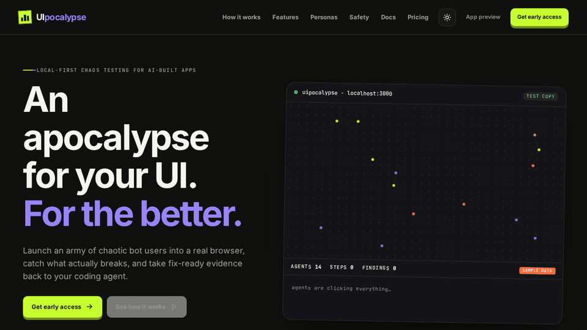
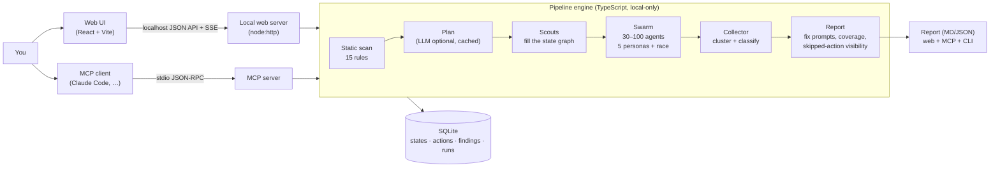

<div align="center">


# UIpocalypse

**Chaos-test locally. Monitor in the cloud.**

**50 chaotic bot users try to break your app in a couple of minutes — before your users do.**

[Features](#features) · [Quickstart](#quickstart) · [How it works](#how-it-works) · [Two products](#two-products-one-mission) · [Safety](#safety) · [Architecture](#architecture)

</div>

---



<div align="center"><sub>Connect a project → launch a run → watch the swarm stream live → read the report with fix prompts</sub></div>

---

## What it does

UIpocalypse launches an army of chaotic bot users into a real browser against your web app. They click everything, double-click money buttons, paste garbage into forms, abandon flows halfway, and race each other — then the tool clusters what broke into an honest report with paste-ready fix prompts for your coding agent.

It finds things that **break**. It does not judge design or UX.

### What the bots find

| Check | What it catches |
|---|---|
| **Dead buttons** | Buttons with no onClick handler — users click, nothing happens |
| **Double-submits** | No submit guard — a double-click charges twice, creates duplicate rows |
| **Race conditions** | 20 agents fire the same action at once — single-use coupons get used twice |
| **Crashes** | Unhandled JS errors from garbage input, edge cases, unexpected states |
| **Broken links** | 404s, 5xx, DNS failures, timeout — internal and external |
| **Missing images** | `` that fails or has zero naturalWidth |
| **Slow pages** | Load time and LCP over thresholds (configurable, not hardcoded) |
| **SSL problems** | Certificates expiring within 14 days |
| **Missing meta** | No title, description, or OG tags for social sharing |
| **Redirect issues** | Chains over 2 hops, infinite loops |
| **Console errors** | Every `console.error`, `pageerror`, and unhandled rejection |

## Quickstart

```bash
# 1. Clone and build
git clone https://github.com/kunalraha-ai/UIpocalypse.git
cd UIpocalypse
cd uipocalypse && npm install && npm run build
cd ../frontend && npm install && npm run build
cd ../uipocalypse

# 2. One-time: install the browser the swarm drives
npx playwright install chromium

# 3. Start the web UI
node dist/index.cjs web    # → http://localhost:4310
```

**Prerequisites:** Node.js 22+, your app running on `localhost`, a disposable test copy (never production).

## How it works

### 1. Connect a project

Open **http://localhost:4310**, click **Connect project**, and enter:
- Your app's **repo path** (or a **GitHub URL** — it shallow-clones automatically) — verified with a real static scan before you continue
- The **URL** your app is running on (`http://localhost:3000` or a **live website** with ownership confirmation)

### 2. Launch a run

Click **New run**, pick your agent count (30–100) and time budget, and hit **Launch**. The phases stream live:

```
Scan → Plan → Scout → Swarm → Report
```

- **Scan** — 15 static rules run in ~1 second: dead handlers, unwired forms, missing guards, exposed secrets, undefined env vars
- **Plan** — personas and seed routes selected (LLM-assisted if a key is set, cached for reruns)
- **Scout** — LLM-guided agents fill the state graph
- **Swarm** — 30–100 headless agents with distinct personalities:
  - **Wanderer** — clicks everything, weighted toward unexplored actions
  - **Double-Clicker** — fires submit-like actions 2–3× in ~50 ms (the duplicate-write hunter)
  - **Garbage Paster** — pastes 10,000-character strings, emoji, null bytes into every form
  - **Abandoner** — leaves multi-step flows halfway, returns later, resumes from odd states
  - **Race Runner** — coordinates 20 agents to fire the same action simultaneously
- **Report** — findings are clustered by fingerprint, ranked by severity, with evidence and fix prompts

### 3. Read the report

Every finding carries:
- **Root cause** — what actually broke and why
- **Reproduction steps** — the exact click chain that triggered it
- **Evidence** — raw request/response data, console errors, screenshots
- **Fix prompt** — a paste-ready block for your coding agent (Cursor, Claude Code, etc.)

The report also states **what was NOT tested** — skipped-by-safety-policy controls, unreachable pages, detection classes that didn't run. Never a silent clean bill of health.

## Two products, one mission

| | **UIpocalypse** (this repo) | **UIpocalypse Cloud** ([sibling repo](https://github.com/kunalraha-ai/UIpocalypse-cloud)) |
|---|---|---|
| **What** | Chaos-tests a **disposable copy** of your app on your machine | Monitors your **live website** for visitor-facing issues |
| **Target** | `localhost` / test copies / GitHub repos | Your live site (ownership-verified) |
| **When** | Before you deploy — vibecoded apps, pre-launch checks, CI | After you deploy — ongoing monitoring, alerts |
| **Port** | `:4310` | `:4311` |
| **Stack** | TypeScript, Playwright, SQLite, React + Vite | Next.js, PostgreSQL, pg-boss, Playwright |

Both share the same design, the same engine concepts, and the same honesty rules. The web UIs cross-link: the local tool's sidebar has a **Cloud Monitoring** link, and the Cloud's header has a **Local Tool** link.

## The MCP server

UIpocalypse also runs as a **Model Context Protocol server** — use it from Claude Code or any MCP client:

```json
{
  "mcpServers": {
    "uipocalypse": {
      "command": "node",
      "args": ["/absolute/path/to/UIpocalypse/uipocalypse/dist/index.cjs"],
      "env": { "UIP_WORKSPACE": "/absolute/path/to/UIpocalypse/uipocalypse" }
    }
  }
}
```

Then just ask: *"use uipocalypse to verify deployment safety: the repo is /path/to/my-app and the app is at http://localhost:3000"*

Tools: `scan_codebase` · `plan_swarm` · `run_swarm` · `get_report` · `list_runs` · `diff_runs` · `verify_deployment_safety`

## Safety

- **Localhost only** by default — non-local targets require an explicit ownership attestation or a `/.well-known/` token
- **Destructive controls never clicked** without explicit per-run opt-in (delete, reset, remove…), and every skip is listed in the report
- **Production databases** get a read-only run — the report states this in its first lines
- **Your code and secrets never leave the machine** — the optional LLM sees only redacted, secret-free summaries (tested: 6/6 leak audit, 0 values in any payload)
- **The LLM is optional** — with no key, everything runs fully local. Every run prints `LLM mode: on/off, provider, key source` before anything happens

**This is experimental software.** Read [`uipocalypse/README.md`](uipocalypse/README.md#scope-and-limits) for the honest scope-and-limits list, and [`BENCHMARK_RESULTS.md`](BENCHMARK_RESULTS.md) for the benchmark record — including what the tool **cannot** detect and where it has known variance.

## Architecture



Everything runs on your machine. The only outbound traffic, ever, is optional redacted summaries to the LLM provider you configure.

## Tech stack

<div align="center">


</div>

| | Layer | Choices |
|---|---|---|
|  | **Engine** | TypeScript (strict), Node.js 22, esbuild bundle |
|  | **Browser automation** | Playwright (Chromium), in-page runtime injected per page |
|  | **State model** | SQLite via better-sqlite3 — state graph, findings, runs (with machine stamps) |
| | **LLM layer** | Any OpenAI-compatible provider; fallback chains; fail-fast health checks; mode line on every run |
|  | **MCP** | @modelcontextprotocol/sdk (stdio) |
|    | **Web UI** | React 19, Vite 8, Tailwind CSS v4, self-hosted Inter + JetBrains Mono (zero external requests) |
| | **Safety** | Guard layer: localhost-only targets, destructive-label regex, DB allow-list, secret redaction on every LLM payload |

## What people found with it

**[GrowthSent](https://www.growthsent.com)** — a real Figma Make–generated monitoring app:
- **14 dead buttons** ("Run fresh scan", "Export CSV", "AI Fix All" — all had no onClick handler)
- **14 undefined env vars** (MongoDB provisioning flags read but never defined in any `.env`)
- **7 live-site issues** (missing meta tags, missing favicon, Cloudflare 403)

Full report: [`GROWTHSENT_SCAN_REPORT.md`](GROWTHSENT_SCAN_REPORT.md)

## Repository layout

```
uipocalypse/        the engine: analyzer, browser runtime, swarm, collector,
                    reviewer, MCP server, web backend, CLI, tests (146)
frontend/           the web UI (React + Vite + Tailwind), talks to the
                    localhost web API on :4310
sample-app/         a demo Next.js + Supabase app with planted bugs
held-out-app-2/     Plain Pages — the held-out detector check fixture
benchmarks/         raw benchmark data and gate logs
docs/volunteer/     the volunteer kit: quickstart, safe-test-copy guide,
                    what-we-see privacy doc, feedback + log templates
releases/           volunteer handoff tarballs (gitignored) + sha256
assets/             brand icons + demo GIF
```

## License

[MIT](uipocalypse/LICENSE) · Terms of use: [`uipocalypse/TERMS.md`](uipocalypse/TERMS.md)

---

<div align="center">

**Break it here, not in production.**

</div>
